<div align="center">

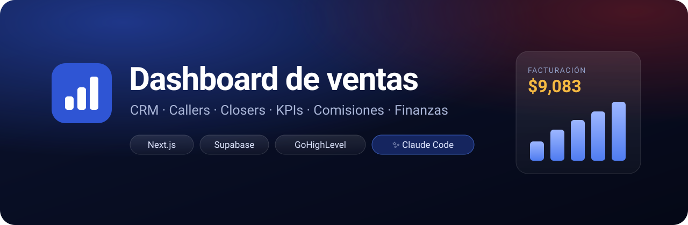

<br>


**El panel de ventas para equipos de callers y closers.**<br>
Cada lead, cada llamada, cada cita y cada venta en un solo sitio, conectado con GoHighLevel.

[🚀 Instalar](#-instalación-en-3-pasos) · [💬 Prompts](#-prompts-listos-para-copiar) · [📸 Capturas](#-así-se-ve) · [🗺️ Cómo funciona](#️-cómo-funciona) · [🎨 Tu marca](#-ponle-tu-marca) · [❓ Dudas](#-preguntas-frecuentes)

</div>

---

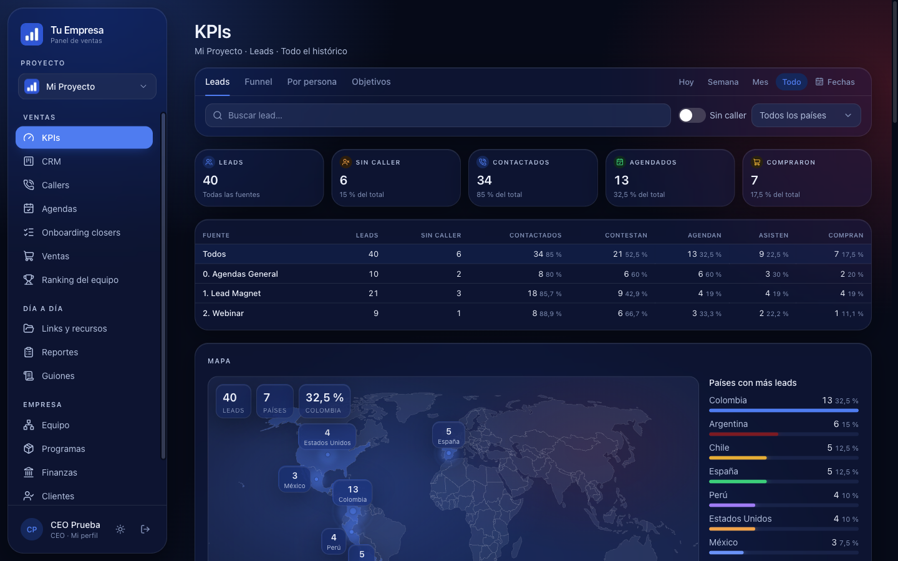

## ✨ Qué incluye

<table>
<tr>
<td width="33%" valign="top">

### 📊 KPIs
Embudo completo (contactados → contestan → agendan → asisten → compran), cada fuente comparada, mapa de países y objetivos por persona.

</td>
<td width="33%" valign="top">

### 🗂️ CRM
Tableros por pipeline como en GHL, arrastrar y soltar, filtros por país y canal, subir CSV y repartir leads en masa.

</td>
<td width="33%" valign="top">

### 📞 Callers
Cola ordenada por prioridad, guion de llamada, WhatsApp en un clic, «llamar luego» y link de agenda.

</td>
</tr>
<tr>
<td valign="top">

### 📅 Agendas
Calendario de cada closer, pre-call y post-call, grabaciones de Fathom y análisis de llamadas con IA.

</td>
<td valign="top">

### 💰 Ventas y finanzas
Pagos únicos, en cuotas y mensuales, cash collected, cuentas por cobrar, gastos, ROAS y liquidaciones.

</td>
<td valign="top">

### 🏆 Equipo
Ranking, comisiones por tramos, reparto automático por %, horarios, permisos por persona y reportes diarios.

</td>
</tr>
</table>

## 📸 Así se ve

<table>
<tr>
<td width="50%">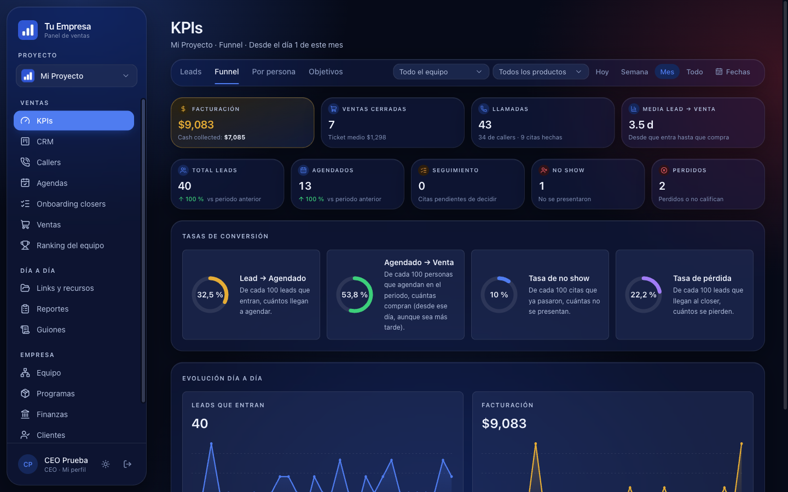<p align="center"><b>Funnel</b> · facturación, ventas y conversión</p></td>
<td width="50%">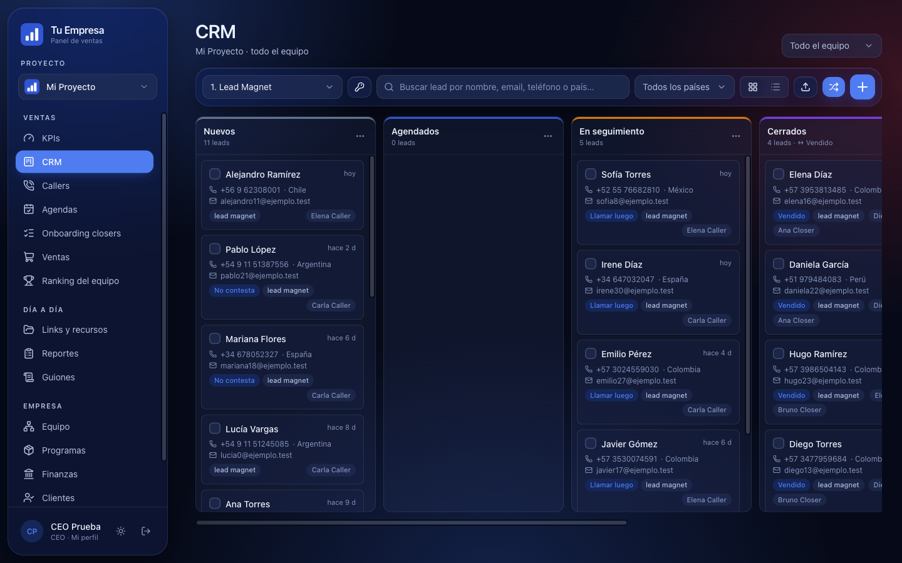<p align="center"><b>CRM</b> · tableros por pipeline</p></td>
</tr>
<tr>
<td>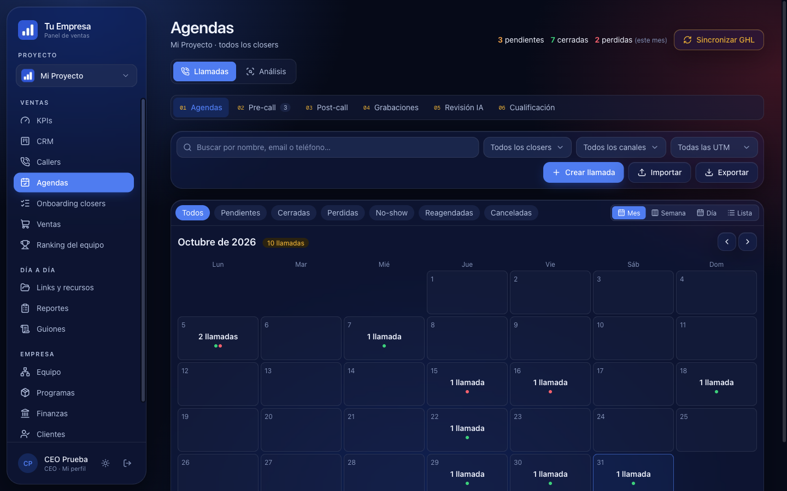<p align="center"><b>Agendas</b> · las llamadas de cada closer</p></td>
<td>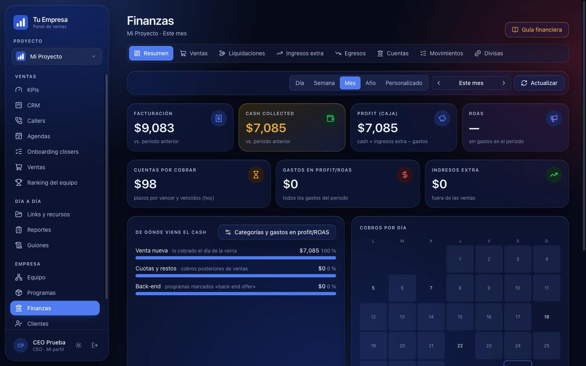<p align="center"><b>Finanzas</b> · cash, profit y cobros</p></td>
</tr>
<tr>
<td>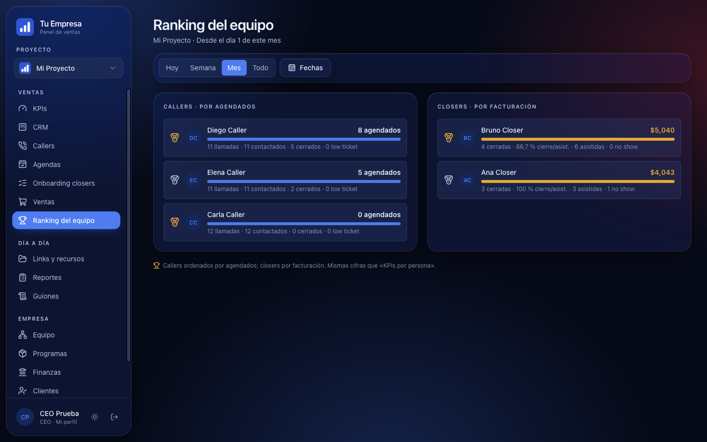<p align="center"><b>Ranking</b> · callers y closers</p></td>
<td>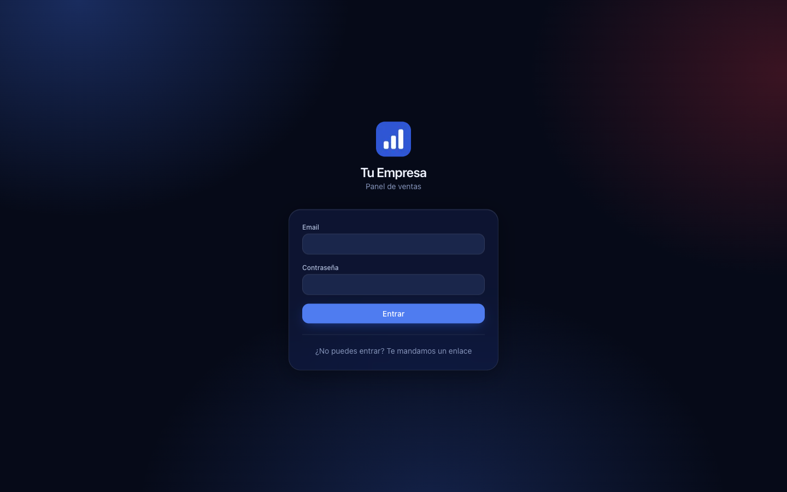<p align="center"><b>Entrada</b> · con tu marca</p></td>
</tr>
</table>

<div align="center">
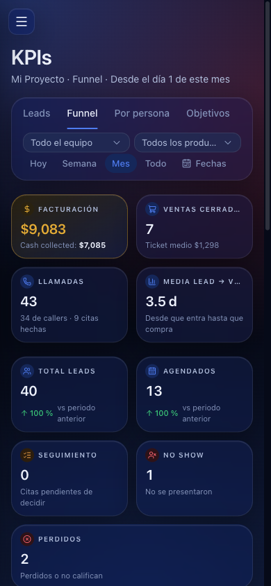&nbsp;&nbsp;&nbsp;&nbsp;
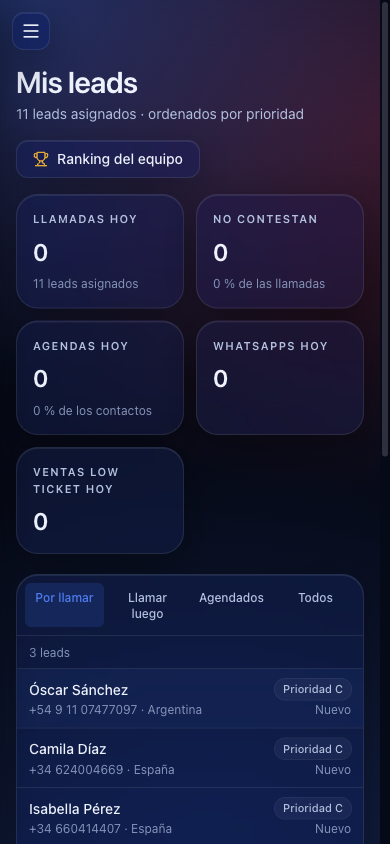
<p><b>📱 También en el móvil</b>: el CEO mira sus números y el caller trabaja su cola desde cualquier sitio.</p>
</div>

> Las capturas usan datos de demostración inventados.

## 🗺️ Cómo funciona

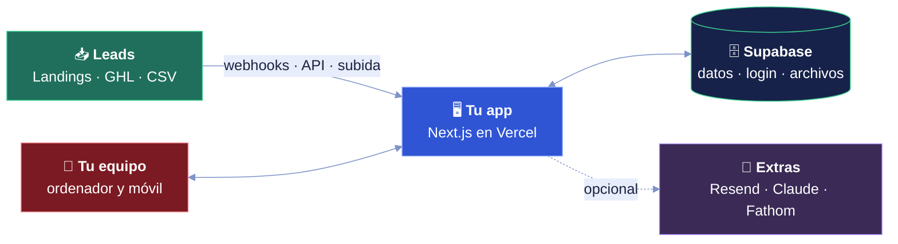

## 🔄 El recorrido de un lead

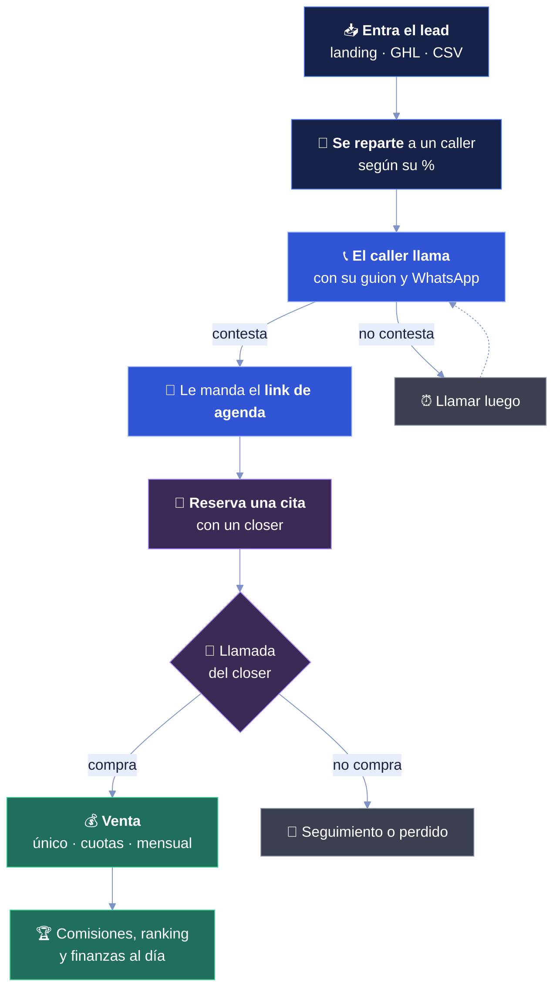

## 👥 Quién ve qué

| Rol | Qué hace en la app |
|---|---|
| 👑 **CEO** | Lo ve todo, en todos los proyectos. Crea proyectos y da de baja a gente. |
| 🧭 **Director** | KPIs, CRM y equipo de su proyecto. Con «Administración», también permisos, comisiones e integraciones. |
| 🤝 **Closer** | Sus agendas, sus llamadas analizadas, sus ventas y el onboarding de sus clientes. |
| 📞 **Caller** | Su cola de leads, su guion, sus agendas y su ranking. |

Cada sección se puede abrir o cerrar por rol y por persona (Administración → Permisos).

---

## 🚀 Instalación en 3 pasos

La forma fácil: **hablando con Claude Code**. El repo trae un [`CLAUDE.md`](CLAUDE.md) que convierte a Claude en tu instalador: ejecuta los comandos, edita los archivos y abre las webs por ti con el navegador (MCP de Playwright). **Tus claves nunca pasan por el chat**: Claude te abre la página y tú las pegas.

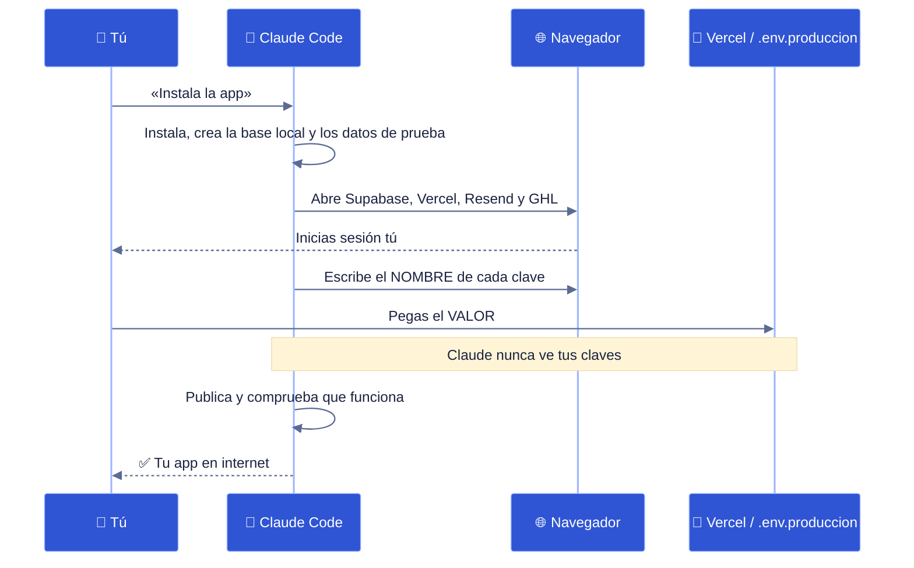

### 1️⃣ Instala lo necesario

| | 🪟 Windows | 🍎 Mac |
|---|---|---|
| **Node.js 22 o más** | [nodejs.org](https://nodejs.org) → instalador LTS | [nodejs.org](https://nodejs.org) → instalador LTS |
| **Git** | [git-scm.com](https://git-scm.com/downloads/win) (Git for Windows) | Viene con Xcode: ejecuta `git --version` y acepta |
| **Docker Desktop** | [docker.com](https://www.docker.com/products/docker-desktop) · deja activado **WSL 2** y reinicia | [docker.com](https://www.docker.com/products/docker-desktop) |
| **Claude Code** | PowerShell: `irm https://claude.ai/install.ps1 \| iex` | Terminal: `curl -fsSL https://claude.ai/install.sh \| bash` |

> Claude Code necesita una cuenta de Claude de pago (Pro o superior). Docker solo hace falta para probar la app en tu ordenador: la app publicada usa Supabase en la nube.

### 2️⃣ Descarga el proyecto

En **PowerShell** (Windows) o en **Terminal** (Mac), los mismos comandos:

```bash
git clone https://github.com/eternitydevzz/dashboard-ventas-maestria.git
cd dashboard-ventas-maestria
```

¿Sin Git? Botón verde **Code → Download ZIP**, descomprímelo y entra en la carpeta `dashboard-ventas-maestria-main`.

### 3️⃣ Abre Claude Code y pídeselo

```bash
claude
```

La primera vez, Claude Code te pregunta si apruebas el servidor **playwright** de este proyecto: di que sí (es el navegador que usará para abrirte las webs). Después pega el primer prompt de abajo. 👇

---

## 💬 Prompts listos para copiar

Pégalos en Claude Code, en este orden. Cada uno es una fase del [`CLAUDE.md`](CLAUDE.md).

<details open>
<summary><b>1 · 💻 Verla funcionando en mi ordenador</b> (10 minutos)</summary>

```text
Lee el CLAUDE.md y haz la Fase 0 y la Fase 1: comprueba que tengo todo lo
necesario en mi sistema, instala la app en mi ordenador con la base de datos
local y los datos de prueba, arráncala y ábremela en el navegador ya dentro
como CEO. Ve paso a paso y dime qué haces.
```

</details>

<details>
<summary><b>2 · 🎨 Ponerle mi marca</b></summary>

```text
Haz la Fase 2 del CLAUDE.md: ponle mi marca a la app. Pregúntame de una en una
el nombre de mi empresa, mi logo, mi color, mis pipelines, mis productos y mis
etiquetas de GoHighLevel. Cuando acabes, enséñame una captura con mi marca.
```

</details>

<details>
<summary><b>3 · 🌍 Publicarla en internet</b></summary>

```text
Haz la Fase 3 del CLAUDE.md: publica la app en internet con GitHub, Supabase,
Vercel y Resend. Ábreme cada web con el navegador y espera a que inicie sesión
yo. Nunca me pidas una clave por el chat: ábreme la página donde se copia y
dime dónde pegarla.
```

</details>

<details>
<summary><b>4 · 🟢 Conectar GoHighLevel</b></summary>

```text
Haz la Fase 4 del CLAUDE.md: conecta mi cuenta de GoHighLevel. Guíame para
crear el token, pegarlo en la app, elegir mis calendarios y activar la lectura
automática. Al final, comprueba con una reserva de prueba que la cita llega a
la app.
```

</details>

<details>
<summary><b>5 · 👥 Dar de alta a mi equipo</b></summary>

```text
Ayúdame a crear los usuarios de mi equipo: hazme las preguntas para el CSV
(nombre, email, rol y proyecto de cada persona), créalo y ejecuta
scripts/crear-usuarios.mjs primero en simulación y luego de verdad, como dice
la Fase 3 del CLAUDE.md. No leas las contraseñas generadas.
```

</details>

<details>
<summary><b>6 · 🧯 Algo no funciona</b></summary>

```text
Algo no funciona en la app: [describe aquí qué ves]. Mira la tabla «Si algo
falla» de docs/GUIA-PUBLICAR.md, revisa los registros y dime qué pasa antes de
cambiar nada.
```

</details>

<details>
<summary><b>7 · 🎓 Explícame cómo funciona</b></summary>

```text
Explícame con palabras sencillas cómo funciona [el reparto de leads / las
comisiones por tramos / la lectura de GHL / los permisos]: qué archivos
intervienen y qué puedo cambiar sin romper nada.
```

</details>

---

## 🎨 Ponle tu marca

Todo está en pocos sitios. Con el prompt 2, Claude lo hace por ti.

| Qué | Dónde |
|---|---|
| 🏷️ Nombre y descripción | `src/lib/marca.ts` |
| 🖼️ Logos | `public/marca/logo.png` y `public/marca/logo-blanco.png` |
| 🎨 Colores | `src/app/globals.css` (`--primario` y `--marca-acento`) |
| ✉️ Remitente de los emails | Variable `EMAIL_REMITENTE` |
| 🗂️ Proyecto, pipelines y productos iniciales | `scripts/proyecto-base.json` |
| 🏷️ Etiquetas de GHL → pipeline | `PIPELINE_ETIQUETA` en `src/lib/ghl-leads.ts` |
| 📡 Canales de las citas (UTM) | `src/lib/canal.ts` |
| 📝 Guiones de llamada | Desde la app, en «Guiones» |

## 🛠️ Instalación manual (sin IA)

<details>
<summary>Ver los comandos</summary>

Con Docker Desktop abierto, en la carpeta del proyecto (iguales en Windows y en Mac):

```bash
npm ci
npx -y supabase@2.90.0 start
npx -y supabase@2.90.0 status -o env
```

Crea `.env.local` copiando `.env.example` y rellena con lo que sale arriba: `NEXT_PUBLIC_SUPABASE_URL` = `API_URL`, `NEXT_PUBLIC_SUPABASE_PUBLISHABLE_KEY` = `PUBLISHABLE_KEY`, `SUPABASE_SECRET_KEY` = `SECRET_KEY`, `APP_URL` = `http://localhost:3000` y `CLAVE_CIFRADO` = el resultado de:

```bash
node -e "console.log(require('crypto').randomBytes(32).toString('base64'))"
```

Después:

```bash
node --env-file=.env.local scripts/seed.mjs
npm run dev
```

Abre http://localhost:3000 y entra con `ceo@ejemplo.test` / `Test1234@`.

Para publicarla: [`docs/GUIA-PUBLICAR.md`](docs/GUIA-PUBLICAR.md). Para GoHighLevel: [`docs/GUIA-GHL.md`](docs/GUIA-GHL.md).

</details>

## 🔒 Seguridad

- 🛡️ La base de datos no se puede leer desde el navegador: **RLS en todas las tablas**.
- 👮 Cada acción comprueba el rol y el permiso de la sección.
- 🔐 El token de GHL y las claves de Fathom se guardan **cifrados** (AES-256-GCM).
- 🚦 Límite de intentos en el login y en los webhooks.
- 📄 Los CSV exportados están protegidos contra fórmulas de Excel.
- 🙈 Ninguna clave de servidor llega al navegador, y a la IA no se le mandan emails ni teléfonos.

## 📁 Estructura

```text
├── CLAUDE.md              ← instrucciones para instalar con Claude Code
├── .mcp.json              ← navegador (Playwright) para Claude Code
├── docs/                  ← guías y capturas
├── public/marca/          ← tus logos
├── scripts/               ← preparar proyecto, crear usuarios, importar CSV
├── src/
│   ├── app/               ← pantallas y API (Next.js)
│   ├── components/        ← piezas de la interfaz
│   └── lib/               ← lógica: leads, KPIs, comisiones, GHL…
├── supabase/migrations/   ← tablas y permisos de la base de datos
└── tests/                 ← tests unitarios y de integración
```

## ❓ Preguntas frecuentes

<details>
<summary><b>¿Cuánto cuesta tenerla funcionando?</b></summary>

Supabase, Vercel y Resend tienen planes gratuitos con los que se puede empezar. La IA (Claude y Deepgram) es opcional y de pago por uso. Revisa los límites de cada plan en su web antes de usarla con mucho volumen.

</details>

<details>
<summary><b>¿Necesito GoHighLevel?</b></summary>

No. Puedes meter leads por CSV o mandar tus landings directo a la app (Administración → Entradas). GHL añade las citas de sus calendarios y los contactos automáticamente.

</details>

<details>
<summary><b>¿Funciona en Windows?</b></summary>

Sí: todos los comandos son de Node (`npm`, `npx`, `node`) y valen igual en Windows y en Mac. Lo único distinto es instalar Docker Desktop con WSL 2 y Claude Code con su comando de PowerShell (tabla del paso 1).

</details>

<details>
<summary><b>¿Puedo tener varios proyectos o marcas?</b></summary>

Sí. El CEO crea proyectos nuevos desde Administración, cada uno con su moneda, zona horaria, pipelines, productos y equipo.

</details>

<details>
<summary><b>¿Dónde están mis claves?</b></summary>

En la nube, en Vercel (Environment Variables). En tu ordenador, en `.env.local` (base de prueba) y `.env.produccion` (scripts), que nunca se suben a GitHub.

</details>

## 🧪 Tests

```bash
npm run test:unit                 # rápidos, sin base de datos
npx vitest run tests/integracion  # con la base local arrancada
```

En GitHub se pasan solos en cada cambio (`.github/workflows/tests.yml`).
